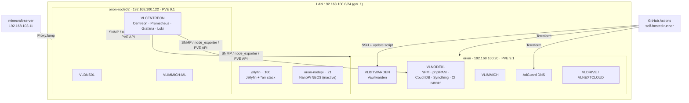

# Architecture

## Overview

Provisioning works in layers, and each layer owns one thing:

1. **Terraform (`servers/`)** creates the VM by cloning a cloud-init template. It sets the
   CPU, RAM, disk, MAC, static IP and root SSH keys.
2. **Terraform (`network/`)** attaches a Proxmox firewall security group to the VM.
3. **Ansible (`main.yml`)** sets up the baseline: an admin user with sudo, SSH keys and
   hardening, bashrc, swap, MOTD and SNMP for Centreon.
4. **Docker Compose (`docker/`)** runs the actual service.
5. **Terraform (`services/AdGuard`)** publishes a friendly local DNS name for it.

## Physical hosts

| Host | IP | Hardware | OS | Role |
|------|----|----------|----|------|
| `orion` | 192.168.100.20 | Lenovo ThinkCentre M70q Gen 5, i5-14400T (16 threads), 16 GB | Proxmox VE 9.1.6 | Primary hypervisor; hosts most VMs and runs the backup timer |
| `orion-node02` | 192.168.100.122 | Dell OptiPlex Micro 7010, i5-13500T (20 threads), 16 GB, 232 GB root | Proxmox VE 9.1.7 | Second hypervisor; monitoring, secondary DNS, Immich ML; jump host to 192.168.103.0/24 |
| `orion-nodepi` | 192.168.100.21 | FriendlyElec NanoPi NEO3 (RK3328, 2 GB), ~470 GB disk | Debian 13 (trixie) | Currently commented out of the Ansible inventory |

> The two PVE nodes appear as separate endpoints in Terraform (each module points at a
> specific node's API). The Prometheus PVE exporter config also treats them as separate
> clusters (`cluster: 0`), so there is no evidence that they are joined into one PVE cluster.

## Virtual machines

Values come from `terraform/prod/servers/*/terraform.tfvars`, the Ansible inventory and
the firewall config. ⚠ marks a place where the sources disagree (see
[known issues](known-issues.md#configuration-drift)).

| VM | VMID | Node | IP | vCPU / RAM / Disk | Template | Runs |
|----|------|------|----|-------------------|----------|------|
| VLBITWARDEN | 19299 | orion | 192.168.100.99 ⚠ (tfvars: .96) | 1 / 256 MB / 4 G | debian-template-restore | Vaultwarden |
| VLNODE01 | 19298 (firewall) | orion | 192.168.100.98 | – (tfvars not in repo) | debian-template-restore | Nginx Proxy Manager, phpIPAM, CouchDB, Syncthing, cAdvisor, Alloy, Komodo Periphery, GitHub Actions runner |
| VLIMMICH | 192104 | orion | 192.168.100.104 | 4 / 3 GB / 25 G | debian-template-restore | Immich (port 2283) |
| VLDRIVE (name `VLNEXTCLOUD`) | 192101 | orion | 192.168.100.101 | 2 / 2 GB / 10 G | debian-template-restore | Nextcloud / "docker" host |
| VLADGUARD-DNS1 | 19205 ⚠ (firewall: 192105) | orion | 192.168.100.97 ⚠ (tfvars: .5) | 1 / 1 GB / 6 G | debian-template-restore | AdGuard Home (primary DNS) |
| VLCENTREON | 192107 | orion-node02 | 192.168.100.107 | 2 / 2 GB / 10 G | template-generic-alma-9.8 | Centreon + Prometheus/Grafana/Loki |
| VLDNS01 (`dnsprod01`) | 19111 | orion-node02 | 192.168.100.111 | 1 / 512 MB / 6 G | debian-template-restore | Secondary DNS |
| VLIMMICH-ML | 192103 | orion-node02 | 192.168.100.103 | 4 / 3 GB / 10 G | debian-template-restore | Immich machine-learning worker |
| jellyfin | – | – | 192.168.100.100 | – (not in Terraform) | – | Jellyfin + *arr stack |
| minecraft-server | – | behind orion-node02 | 192.168.103.11 | – | – | Minecraft; reached with `ProxyJump orion-node02` |
| VLABITWARDEN | – | – | – | – (no tfvars) | – | Leftover copy of the Bitwarden module |

**VMID convention.** The IDs mostly follow `192` + the last IP octet (`192104` → `.104`,
`192107` → `.107`), and older VMs use `192xx`/`191xx`. Keeping to this makes it easy to
tell which VM owns which IP.

## Network & DNS

- A single flat subnet `192.168.100.0/24` with gateway `192.168.100.1`, bridged on `vmbr0`
  on both nodes. `192.168.103.0/24` sits behind `orion-node02`.
- VM MACs use the Proxmox prefix `BC:24:11:` and are pinned in Terraform so DHCP
  reservations and phpIPAM stay stable.
- **AdGuard Home** (`192.168.100.97`) is the LAN resolver. It does ad and tracker blocking
  and serves local names through DNS rewrites:

| Name | Answer |
|------|--------|
| `orion` | 192.168.100.20 |
| `orion-node02` | 192.168.100.122 |
| `dns` | 192.168.100.97 |
| `node01` | 192.168.100.98 |
| `bitwarden` | 192.168.100.99 |
| `jellyfin` | 192.168.100.100 |
| `immich-ml` | 192.168.100.103 |
| `immich` | 192.168.100.104 |
| `vlcentreon` | 192.168.100.107 |
| `centreon-prod` | → `vlcentreon` (CNAME-style) |
| `vldns0` | 192.168.100.111 |

- **Reverse proxy.** Nginx Proxy Manager on VLNODE01 (ports 80/443, admin on 81) puts TLS
  in front of the internal services. Per the README, *nothing is exposed publicly*.
- **SSH client config.** The `ssh` Ansible role drops `/etc/ssh/ssh_config.d/homelab.conf`
  on every host, so short aliases like `ssh orion` or `ssh bitwarden` work from anywhere
  in the lab.

## Firewall model

The firewall is managed in `terraform/prod/network/firewall.tf` with the `bpg/proxmox` provider:

- The datacenter firewall is **enabled** with an ACCEPT/ACCEPT baseline, so VMs without a
  policy are unaffected.
- Each protected VM gets its own **security group** and a VM-level `input_policy = DROP`.
  Only the listed ports get through, and all outbound traffic is allowed.
- The groups that exist today are `vaultwarden-sg`, `vlnode01-sg`, `immich-sg` and
  `adguard-sg`. They're listed port by port in [terraform.md](terraform.md#network--proxmox-firewall).

Every group allows SSH (22), ICMP and SNMP (161) so that management and Centreon
monitoring keep working.
